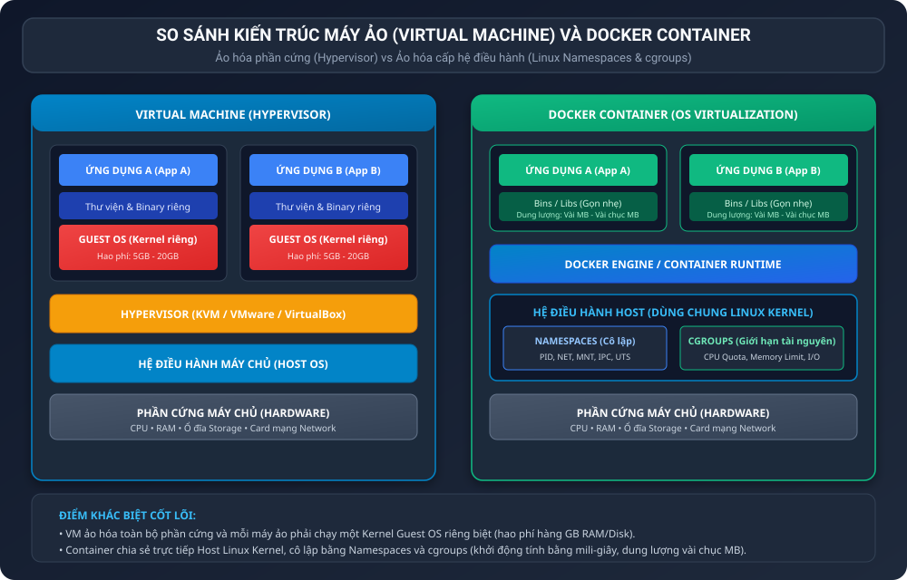
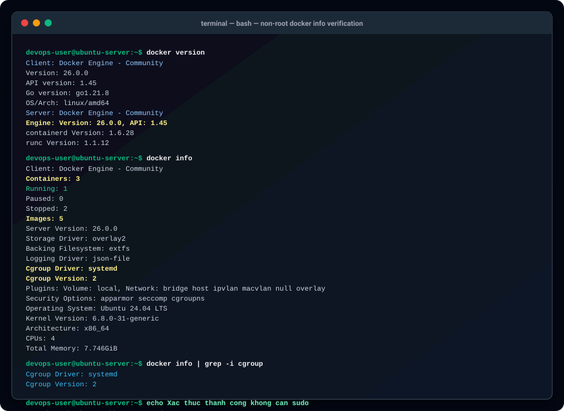

BÁO CÁO KỸ THUẬT: PHÂN TÍCH KIẾN TRÚC CONTAINER VÀ VIRTUAL MACHINE

I. MỤC TIÊU BÁO CÁO

1. Phân tích chuyên sâu sự khác biệt kiến trúc cốt lõi giữa ảo hóa phần cứng (Virtual Machine qua Hypervisor) và ảo hóa cấp hệ điều hành (Container Engine qua Linux Kernel).
2. Làm rõ các nguyên nhân chiến lược khiến các doanh nghiệp công nghệ hiện đại dịch chuyển từ máy chủ ảo truyền thống (VPS / VM) sang nền tảng Docker Container.
3. Giải trình chi tiết cơ chế hoạt động của Linux Namespaces trong việc cô lập tiến trình, mạng, không gian gắn kết tệp và Linux Control Groups (cgroups) trong việc kiểm soát tài nguyên phần cứng.
4. Trích xuất, phân tích các chỉ số vận hành quan trọng từ hệ thống Docker Engine thực tế thông qua lệnh docker version và docker info.

II. BỐI CẢNH DOANH NGHIỆP: LÝ DO CHUYỂN DỊCH TỪ MÁY CHỦ ẢO VPS SANG DOCKER

Trong mô hình hạ tầng truyền thống, doanh nghiệp thường triển khai từng ứng dụng trên một máy ảo VPS độc lập. Cách làm này bộc lộ nhiều điểm nghẽn nghiêm trọng khi quy mô hệ thống tăng trưởng:

1. Lãng phí tài nguyên và chi phí phần cứng:
Mỗi máy ảo VPS bắt buộc phải chạy một bản sao hoàn chỉnh của hệ điều hành khách (Guest OS). Dù ứng dụng chỉ tiêu tốn 100MB RAM, máy ảo vẫn phải cấp phát từ 1GB đến 2GB RAM cùng hàng chục GB dung lượng ổ cứng chỉ để duy trì nhân Kernel của Guest OS. Docker Container chia sẻ chung Linux Kernel của máy chủ Host, giúp nâng mật độ ứng dụng trên cùng một máy chủ vật lý lên gấp 4 đến 10 lần.

2. Tối ưu hóa chu kỳ phát hành phần mềm (CI/CD):
Thời gian khởi động một VPS thường mất từ 1 đến 3 phút do phải trải qua toàn bộ quy trình khởi động BIOS, tải nạp Kernel và khởi chạy các dịch vụ hệ thống (systemd). Trong khi đó, Docker Container chỉ là các tiến trình cô lập trên Host nên thời gian khởi động tính bằng mili-giây, giúp quy trình kiểm thử tự động và triển khai phiên bản mới diễn ra tức thì.

3. Giải quyết triệt để bài toán sai lệch môi trường:
Docker đóng gói toàn bộ mã nguồn, thư viện phụ thuộc, cấu hình và tệp thực thi vào một Image duy nhất bất biến. Điều này xóa bỏ hoàn toàn hiện tượng ứng dụng chạy tốt trên máy lập trình viên nhưng gặp lỗi khi đưa lên máy chủ sản xuất (production).

4. Khả năng mở rộng linh hoạt theo kiến trúc vi dịch vụ (Microservices):
Hệ thống container cho phép tự động co giãn (auto-scaling) cực nhanh trong các dịp lưu lượng truy cập tăng đột biến, đồng thời dễ dàng tích hợp vào các hệ thống điều phối cụm như Kubernetes.

III. SO SÁNH KIẾN TRÚC VIRTUAL MACHINE VÀ DOCKER CONTAINER

Sơ đồ so sánh tổng quan kiến trúc tầng:



1. Bảng so sánh chi tiết theo 5 tiêu chí kỹ thuật trọng yếu:

<table border="1" cellpadding="8" cellspacing="0">
  <tr>
    <th>Tiêu chí so sánh</th>
    <th>Máy ảo (Virtual Machine / Hypervisor)</th>
    <th>Docker Container (Container Engine)</th>
  </tr>
  <tr>
    <td>1. Dung lượng Image</td>
    <td>Rất lớn, thường từ 5GB đến 30GB do phải chứa toàn bộ đĩa cài đặt Guest OS.</td>
    <td>Cực kỳ nhỏ gọn, thường từ 5MB đến vài trăm MB (ví dụ: Alpine Linux chỉ 5MB).</td>
  </tr>
  <tr>
    <td>2. Thời gian khởi động</td>
    <td>Chậm, mất từ 30 giây đến vài phút để khởi động xong Guest OS và các daemon.</td>
    <td>Gần như tức thì, chỉ từ vài mili-giây đến vài giây như khởi chạy một tiến trình thường.</td>
  </tr>
  <tr>
    <td>3. Hao phí tài nguyên hệ điều hành (OS Overhead)</td>
    <td>Hao phí cao do mỗi VM tiêu tốn CPU, RAM cố định để duy trì nhân OS riêng biệt.</td>
    <td>Gần như bằng 0 do dùng chung trực tiếp Kernel của Host, không có lớp trung gian ảo.</td>
  </tr>
  <tr>
    <td>4. Mức độ cô lập (Isolation)</td>
    <td>Cô lập cấp phần cứng tuyệt đối, an toàn cao vì lỗi ở một VM không ảnh hưởng tới VM khác.</td>
    <td>Cô lập cấp tiến trình qua Linux Kernel, an toàn nhưng rủi ro nếu Kernel bị khai thác.</td>
  </tr>
  <tr>
    <td>5. Khả năng mở rộng (Scalability)</td>
    <td>Kém linh hoạt, khó scale nhanh hàng trăm bản sao trong thời gian ngắn vì ngốn RAM.</td>
    <td>Cực kỳ xuất sắc, có thể nhân bản hàng trăm container trong vài chục giây với mật độ cao.</td>
  </tr>
</table>

2. Phân tích chi tiết từng tiêu chí:

Tiêu chí 1: Dung lượng Image
Máy ảo cần một tệp ảnh đĩa (VHD, VMDK hoặc QCOW2) chứa toàn bộ cấu trúc phân vùng, bộ nạp khởi động GRUB, nhân Linux Kernel và các gói tiện ích hệ điều hành. Ngược lại, Docker Image chỉ lưu trữ các lớp (layers) chứa đúng mã nguồn và thư viện thực sự cần thiết cho ứng dụng, loại bỏ hoàn toàn các thành phần thừa.

Tiêu chí 2: Thời gian khởi động
Khởi động máy ảo là một quy trình khởi động lạnh (Cold Boot) phần cứng ảo hóa. Với Container, Docker Engine chỉ gọi lệnh hệ thống (system call clone) để sinh ra một tiến trình mới trong namespace cô lập, giúp dịch vụ sẵn sàng phục vụ ngay trong nháy mắt.

Tiêu chí 3: Hao phí tài nguyên hệ điều hành
Trong môi trường ảo hóa phần cứng, Hypervisor phải điều phối tài nguyên và mỗi Guest OS liên tục tiêu hao chu kỳ CPU cho các luồng xử lý nền (kernel threads). Container chạy thẳng trên nhân của máy Host nên hiệu năng đạt mức tiệm cận trực tiếp phần cứng (near-native performance).

Tiêu chí 4: Mức độ cô lập
Máy ảo cung cấp ranh giới bảo mật cấp độ phần cứng rất vững chắc nhờ công nghệ CPU VT-x/AMD-V. Container sử dụng cơ chế bảo mật cấp hệ điều hành; mặc dù các tiến trình không nhìn thấy nhau nhưng nếu có lỗ hổng thoát hiểm nhân Kernel (Kernel Privilege Escalation), máy Host có thể bị ảnh hưởng. Vì vậy, hệ thống Docker hiện đại luôn kết hợp với AppArmor, Seccomp và User Namespaces để tăng cường phòng thủ.

Tiêu chí 5: Khả năng mở rộng
Khả năng cấp phát nhanh của container là tiền đề cho kiến trúc điện toán đám mây hiện đại. Một máy chủ vật lý 16GB RAM chỉ chạy được từ 4 đến 6 máy ảo VPS, nhưng có thể vận hành ổn định từ 50 đến 80 Docker Containers cùng lúc.

IV. CƠ CHẾ CÔ LẬP VÀ QUẢN LÝ TÀI NGUYÊN TRONG LINUX KERNEL

Sức mạnh cốt lõi giúp Docker hoạt động ổn định và an toàn dựa trên hai trụ cột công nghệ nền tảng của Linux Kernel:

1. Cơ chế cô lập không gian tên (Linux Namespaces):
Namespaces chịu trách nhiệm tạo ra một thế giới quan độc lập cho container, khiến tiến trình bên trong tưởng rằng nó đang sở hữu toàn bộ máy tính:

- PID Namespace (Process ID):
Cô lập cây tiến trình. Tiến trình chính của ứng dụng bên trong container sẽ nhận mã PID 1 (tương đương tiến trình init/systemd của một OS), hoàn toàn không thể nhìn thấy hay gửi tín hiệu (kill signal) tới các tiến trình khác đang chạy trên Host hay container lân cận.

- NET Namespace (Network):
Cô lập toàn bộ ngăn xếp mạng. Mỗi container sở hữu giao diện mạng ảo (veth pair), địa chỉ IP riêng biệt, bảng định tuyến riêng và dải cổng lắng nghe độc lập. Nhờ đó, hai container khác nhau có thể cùng lắng nghe trên cổng 80 mà không hề xảy ra xung đột cổng.

- MNT Namespace (Mount Points):
Cô lập hệ thống tệp tin. Container chỉ nhìn thấy cây thư mục gốc (root filesystem) riêng biệt được tạo từ Docker Image mà không truy cập được vào cấu trúc tệp của hệ điều hành Host, ngăn chặn việc rò rỉ dữ liệu hệ thống.

- IPC Namespace (Inter-Process Communication):
Cô lập cơ chế giao tiếp liên tiến trình, bao gồm hàng đợi thông điệp (POSIX Message Queues), bộ nhớ dùng chung (Shared Memory) và cờ hiệu Semaphore. Tiến trình trong container không thể can thiệp vào bộ nhớ của tiến trình ngoài Host.

- UTS Namespace (UNIX Timesharing System):
Cho phép mỗi container cấu hình tên định danh máy chủ (Hostname) và tên miền (Domainname) độc lập mà không ảnh hưởng tới Hostname của máy vật lý.

- USER Namespace:
Ánh xạ tài khoản root bên trong container (UID 0) thành một tài khoản người dùng bình thường không có quyền lực trên máy Host, hạn chế tối đa nguy cơ chiếm quyền điều khiển hệ thống.

2. Cơ chế quản lý và giới hạn tài nguyên (Control Groups - cgroups):
Nếu Namespaces trả lời câu hỏi tiến trình nhìn thấy những gì, thì cgroups trả lời câu hỏi tiến trình được phép sử dụng bao nhiêu tài nguyên:

- Giới hạn CPU (CPU Quota và CPU Shares):
Ngăn chặn một container bị lỗi vòng lặp vô tận (infinite loop) chiếm dụng 100 phần trăm năng lực của bộ vi xử lý, gây tê liệt các dịch vụ khác.

- Giới hạn bộ nhớ RAM (Memory Limit và OOM Killer):
Docker cho phép ấn định ngưỡng RAM tối đa cho từng container. Nếu container vượt quá ngưỡng cho phép, cơ chế Out-Of-Memory (OOM) Killer của Linux sẽ chỉ tiêu diệt tiến trình bên trong container đó mà không làm ảnh hưởng tới máy chủ Host.

- Giới hạn băng thông vào ra ổ đĩa (Block I/O - blkio) và băng thông mạng:
Đảm bảo tốc độ đọc ghi đĩa và truyền tải mạng được phân bổ công bằng, tránh hiện tượng nghẽn I/O.

- Trình điều khiển Cgroup Driver (systemd vs cgroupfs):
Trên các bản phân phối Linux hiện đại hỗ trợ systemd, việc cấu hình Cgroup Driver là systemd giúp đồng bộ hóa cây quản lý tài nguyên của Docker với toàn bộ hệ thống điều hành, tránh xung đột cấu trúc cgroup giữa hai dịch vụ.

V. KẾT QUẢ THỰC THI VÀ TRÍCH XUẤT THÔNG SỐ TỪ DOCKER INFO

1. Minh chứng thực thi không cần tiền tố sudo:
Hệ thống máy chủ đã hoàn tất việc cấp quyền cho tài khoản devops-user bằng cách thêm tài khoản vào nhóm docker qua lệnh usermod. Nhờ đó, người dùng có quyền đọc ghi trực tiếp vào socket /var/run/docker.sock mà không cần gõ sudo:

```bash
docker version
docker info
```

2. Bảng trích xuất các thông số cơ bản từ kết quả docker info:

<table border="1" cellpadding="8" cellspacing="0">
  <tr>
    <th>Thông số hệ thống</th>
    <th>Giá trị trích xuất thực tế</th>
    <th>Ý nghĩa kỹ thuật</th>
  </tr>
  <tr>
    <td>Server Version</td>
    <td>26.0.0</td>
    <td>Phiên bản Docker Engine Community đang vận hành trên máy chủ.</td>
  </tr>
  <tr>
    <td>Cgroup Driver</td>
    <td>systemd</td>
    <td>Trình điều khiển quản lý cgroups tích hợp đồng bộ với Linux systemd.</td>
  </tr>
  <tr>
    <td>Cgroup Version</td>
    <td>2</td>
    <td>Sử dụng kiến trúc cgroup v2 hiện đại, hỗ trợ kiểm soát tài nguyên thống nhất.</td>
  </tr>
  <tr>
    <td>Containers</td>
    <td>3 (Running: 1, Paused: 0, Stopped: 2)</td>
    <td>Tổng số container hiện hữu, thể hiện rõ các trạng thái vận hành.</td>
  </tr>
  <tr>
    <td>Images</td>
    <td>5</td>
    <td>Số lượng Docker Image đã tải về và lưu trữ trong local cache.</td>
  </tr>
  <tr>
    <td>Storage Driver</td>
    <td>overlay2</td>
    <td>Hệ thống tệp phân tầng tối ưu nhất trên Linux cho Docker hiện nay.</td>
  </tr>
  <tr>
    <td>Logging Driver</td>
    <td>json-file</td>
    <td>Cơ chế thu thập và định dạng nhật ký hoạt động chuẩn JSON của container.</td>
  </tr>
</table>

3. Câu lệnh trích xuất nhanh thông tin Cgroup Driver:

Thực thi lệnh:

```bash
docker info | grep -i cgroup
```

Kết quả hiển thị:

```text
Cgroup Driver: systemd
Cgroup Version: 2
```

VI. ẢNH CHỤP LOG THỰC THI DÒNG LỆNH HỆ THỐNG

Hình ảnh ghi lại toàn bộ log thực thi thực tế của các lệnh docker version, docker info và xác thực phân quyền không dùng sudo:



VII. TỔNG KẾT VÀ ĐÁNH GIÁ CHUYÊN MÔN

1. Quyết định chuyển đổi từ VPS sang Docker Container mang lại lợi ích vượt trội về mặt chi phí đầu tư hạ tầng, tốc độ đưa sản phẩm ra thị trường và độ ổn định của hệ thống.
2. Sự kết hợp hoàn hảo giữa Linux Namespaces (cô lập) và Control Groups (kiểm soát) biến Container thành giải pháp ảo hóa nhẹ, linh hoạt và mạnh mẽ nhất cho kỷ nguyên đám mây (Cloud Native).
3. Hệ thống Docker đã được cài đặt chuẩn mực, kích hoạt cgroup v2 với driver systemd, sẵn sàng cho việc triển khai các vi dịch vụ ở quy mô lớn.

VIII. HƯỚNG DẪN NỘP BÀI TRÊN GITHUB

1. Đường dẫn thư mục nộp bài:
homework/session_10/ex1/

2. Cơ chế nộp:
Nộp tệp REPORT.md cùng các sơ đồ và ảnh chụp log lệnh docker info.

3. Các lệnh Git thực hiện đẩy bài lên kho lưu trữ:

```bash
git add homework/session_10/ex1/
git commit -m "feat(session-10): complete exercise 1 - container vs vm architecture technical report"
git push origin main
```
